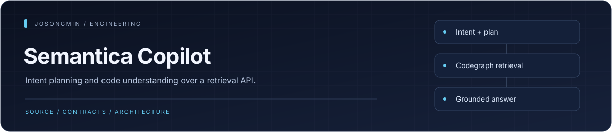
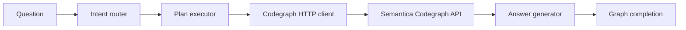

<p align="center"></p>

# Semantica Copilot

A Python code-understanding agent built with LangGraph and the Semantica Codegraph HTTP API. It turns a question into an execution plan, retrieves code context, and produces an answer from the collected results.


## Engineering highlights

| Mechanism | Engineering purpose |
| :--- | :--- |
| **Typed agent state** | A Pydantic state model carries the question, plan, retrieved context, and generated answer between graph nodes. |
| **Intent-to-execution pipeline** | The graph separates intent routing, plan execution, and answer generation. |
| **Retrieval as a service boundary** | The Codegraph HTTP client owns backend integration; retrieval capabilities belong to the configured backend. |
| **Separate entry paths** | The graph-backed server and simpler single-search CLI are distinct integrations, with different execution scope. |


## Architecture at a glance



## Execution model

```text
intent_router → plan_executor → answer_generator → END
```

The current [agent graph](src/semantica_copilot/agent/graph.py) is sequential and has no iterative retrieval loop. Pydantic models carry state, and the [Codegraph client](src/semantica_copilot/tools/codegraph.py) supplies retrieval through the configured backend.

| Path | Responsibility |
| --- | --- |
| [agent](src/semantica_copilot/agent) | Intent routing, plan execution, and answer generation |
| [tools](src/semantica_copilot/tools) | Codegraph API integration |
| [llm](src/semantica_copilot/llm) | Provider and prompt composition |
| [apps/server](src/semantica_copilot/apps/server) | FastAPI application |
| [tests](tests) | Agent, client, error, and integration checks |

## Quick start

Use Python 3.10+, a running [Codegraph API](https://github.com/josongmin/semantica-codegraph), and an indexed repository in that backend.

```sh
python -m venv .venv
source .venv/bin/activate
python -m pip install -e ".[dev]"
semantica-copilot "HybridRetriever" semantica-codegraph
```

The CLI defaults to `http://localhost:8000`. Its second argument is a comma-separated list of repository IDs. The module entry point is equivalent:

```sh
python -m semantica_copilot.cli.main "HybridRetriever" semantica-codegraph
```

This CLI is the single-search integration path. The LangGraph pipeline and server are separate entry points; model-backed execution additionally needs [provider configuration](src/semantica_copilot/llm/provider.py).

## Development

```sh
python -m pytest
```

External API and model tests require their respective services. Historical phase-completion notes do not establish current production qualification.

## Documentation

- [Architecture decisions](docs/adr)
- [Codegraph API adapter](docs/codegraph-api-adapter.md)
- [Integration testing](docs/integration-testing.md)
